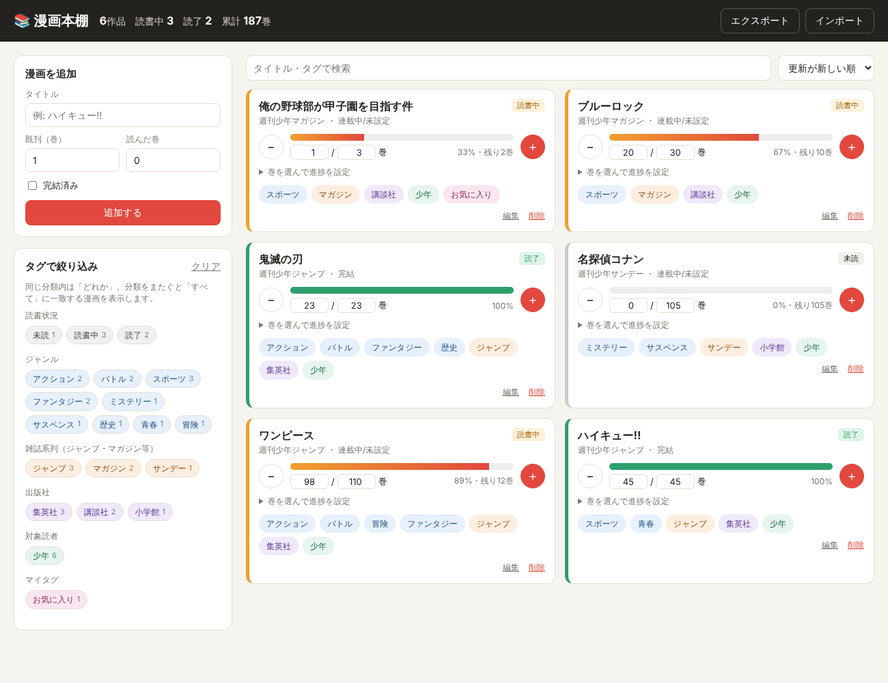

# 📚 漫画本棚 — 漫画の読書進捗管理アプリ

漫画の「既刊のうち何巻まで読んだか」を記録し、ジャンル・雑誌・出版社などのタグで整理・絞り込みできるWebアプリです。
ビルド不要で、`index.html` をブラウザで開くだけで動きます。データはブラウザ（localStorage）に保存されます。



## 主な機能

### 読書進捗
- 既刊数と「何巻まで読んだか」を入力
- `＋` / `−` ボタンで1巻ずつ進める・戻す、数値を直接入力、巻ボタン（1, 2, 3…）をクリックしてその巻まで既読にする
- 進捗バーと「残り◯巻」を表示
- 読書状況を自動判定：**未読 / 読書中 / 最新巻まで既読**（連載中で追いついた状態）/ **読了**（完結済みを全巻読了）

### タイトルからの自動タグ付け
タイトルを入力すると、次の切り口のタグが自動で付きます（追加フォームでリアルタイムにプレビュー）。

| 切り口 | 例 |
| --- | --- |
| ジャンル | スポーツ、アクション、バトル、恋愛、ラブコメ、ファンタジー、異世界、ミステリー、ホラー、グルメ … |
| 雑誌系列 | ジャンプ、マガジン、サンデー、チャンピオン、ガンガン、きらら … |
| 出版社 | 集英社、講談社、小学館、秋田書店 … |
| 対象読者 | 少年、青年、少女、女性 |
| マイタグ | 自由に追加（例: お気に入り、積読） |

分類のしくみ（`js/classifier.js`）:
1. **作品辞書との照合**（`js/dictionary.js`）— 有名作品約90タイトルを登録。「ワンピース」「ONE PIECE 107巻」「ｽﾗﾑﾀﾞﾝｸ」など表記ゆれ・略称・巻数付きでも判定します。掲載誌から出版社・系列・対象読者も自動で決まります。
2. **キーワード推測** — 辞書にない作品は、タイトル中の単語（「野球」→スポーツ、「異世界」「転生」→異世界、「探偵」→ミステリーなど）からジャンルを推測します。

自動タグは編集画面からいつでも追加・削除できます。掲載誌を選ぶと出版社などが自動設定され、「タイトルから再分類」でやり直すこともできます。

### 絞り込み・整理
- サイドバーのタグをクリックして絞り込み（カード上のタグをクリックしてもOK）
  - 同じ切り口内は **OR**（例: スポーツ または 恋愛）
  - 切り口をまたぐと **AND**（例: スポーツ かつ ジャンプ）
- 各タグに該当件数を表示
- タイトル・タグのキーワード検索、並び替え（更新順 / タイトル順 / 進捗順 / 未読巻の多い順）
- JSONでエクスポート / インポート（バックアップ・端末移行用）

## ファイル構成

```
index.html           画面
css/style.css        スタイル
js/dictionary.js     作品辞書・掲載誌→出版社対応表・キーワードルール
js/classifier.js     自動分類ロジック
js/app.js            画面の動作・保存・絞り込み
test/classifier.test.js  分類ロジックのテスト（node test/classifier.test.js）
```

## 作品辞書の追加方法

`js/dictionary.js` の `TITLES` に1行追加します。

```js
{ t: '正式タイトル', a: ['別名', '略称'], g: ['ジャンル1', 'ジャンル2'], m: '週刊少年ジャンプ' },
```

`m`（掲載誌）は `MAGAZINES` に登録されている名前を使うと、出版社・系列・対象読者が自動で付きます。
